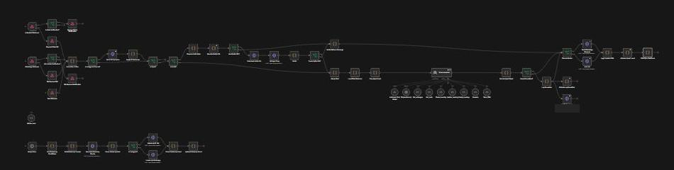
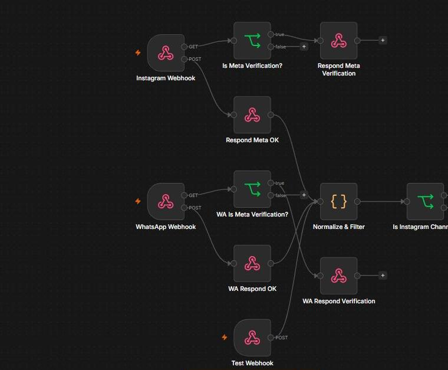
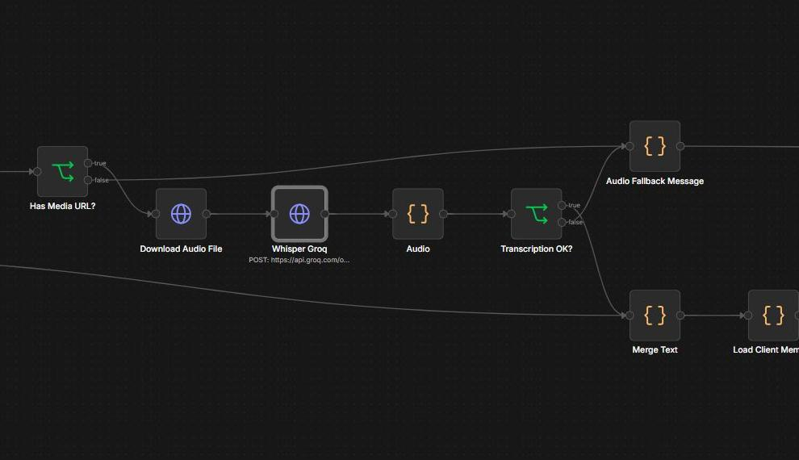
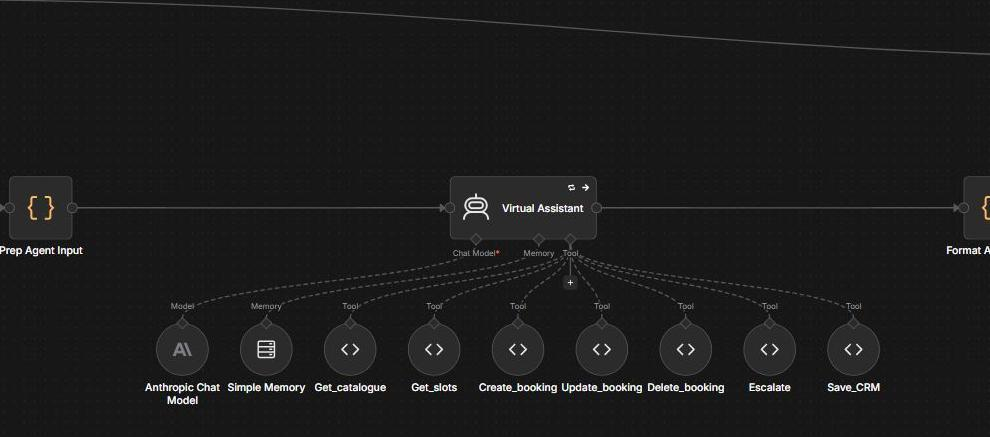
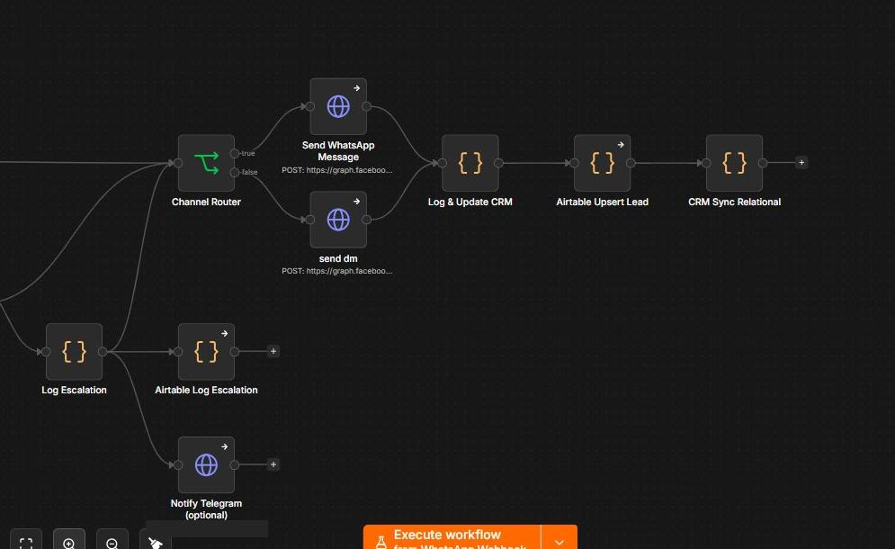

# AI Appointment & Lead Assistant for n8n

A customizable workflow for Instagram and WhatsApp enquiries, audio transcription, appointment tools, Airtable lead tracking, human handoff and scheduled follow-ups.

Actual n8n editor screenshots supplied by the workflow author. These illustrate the workflow architecture; they do not verify the sanitized template's configuration or execution.

## Workflow screenshots

### Instagram and WhatsApp webhooks

Webhook entry points, Meta verification and message normalization.

### Audio transcription

Audio download, Groq transcription and fallback handling.

### AI assistant and tools

The assistant connects to its chat model, memory, catalogue, appointment tools, escalation and CRM tools.

### Replies, CRM and escalation

Channel routing, Airtable lead updates, relational CRM synchronization and optional Telegram notifications.

Download [workflow.json](workflow.json) and read [BUYER_SETUP.md](BUYER_SETUP.md), alongside the corrections in [REVIEW.md](REVIEW.md).

**Status: template draft under review.** The generic export is not yet verified end to end with a fresh buyer configuration. It should not currently be advertised as a plug-and-play paid product.

## What it includes

- Instagram and WhatsApp webhook entry points and response routing.
- Audio download and transcription through Groq.
- An Anthropic-powered conversational agent.
- Catalogue, booking, rescheduling, cancellation and CRM tools.
- Airtable lead and escalation handling, with optional relational CRM.
- A daily follow-up branch and optional Telegram notification.
- Setup notes on the workflow canvas.

## Setup overview

Import the generic JSON into a separate n8n workflow and leave it inactive. Configure your own Meta, Anthropic, Groq, Airtable and Cal.com accounts. Replace the business profile, catalogue, event mappings and webhook paths. Validate each integration with test contacts and future appointment dates before activation.

Some HTTP nodes provide n8n credential selectors. Direct API calls inside Code nodes still use placeholders; their migration to credential-backed nodes is unfinished. Business names, prices and policies belong in configuration, rather than in secret credentials.

## Review before release

See [REVIEW.md](REVIEW.md) for the current publication blockers. Syntax validation alone does not establish that messaging, booking, transcription or CRM operations work after customization.

## Commercial distribution

The intended product is a downloadable workflow for buyers to run in their own n8n accounts. Hosting, AI usage and third-party service charges are separate. Keep the downloadable implementation in a private repository if access will be sold; a public repository makes its contents downloadable by anyone.

No licence or resale permission is granted by this README. Choose distribution terms before a commercial release, and check attribution requirements for any reused third-party work.
